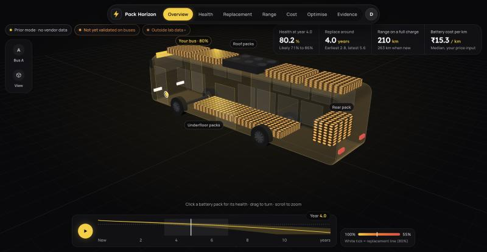
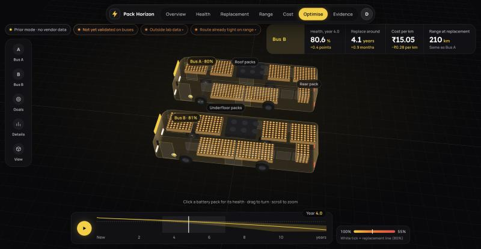
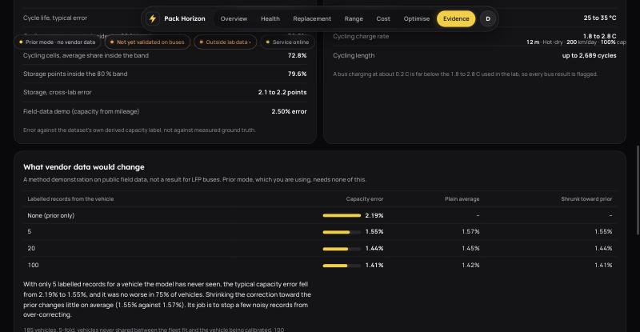

# Pack Horizon: E-Bus Battery Lifecycle Tool

College course project (non-commercial). Forecasts battery health and replacement timing for Indian city e-buses (12 m and 9 m, LFP packs, overnight depot charging), designed like a B2B decision tool. No client, city or operator is named.



| | |
|---|---|
|  |  |

Screenshots are from the running app (Prior mode) and predate two changes: the interface redesign and the switch of the ageing engine to the NREL models. Their layout and their replacement and cost numbers are out of date (they show our earlier laboratory-fitted model, which gave about 4 years for the default bus; the app now gives about 12). Every number is a model output labelled "not yet validated on buses".

## Honesty rules
- Real, free public data only; nothing synthetic. Cell ageing comes from published laboratory-fitted models (NREL BLAST-Lite), weather from NASA POWER.
- Works standalone ("Prior mode") from those models plus clearly labelled assumptions.
- Every output is marked "not yet validated on buses".
- Vendor data may only calibrate, never be required. A working calibration method is demonstrated on public field data (Evidence page, `docs/calibration-interface.md`) but is deliberately not wired into the app.
- BMS-reported state of health is never treated as ground truth.

## Quick start
Needs Python 3.12 or newer and Node 20 or newer. The ageing equations and parameters are in the repository, so nothing has to be downloaded or trained to run the app.

```bash
git clone https://github.com/shalllwilll/EV-Battery-Optimization.git
cd EV-Battery-Optimization
scripts/setup_env.sh            # creates .venv and installs the Python dependencies
scripts/run_all.sh              # builds the frontend on first run, then serves app and API on http://localhost:8000
```

Sign in with the demo account (username `demo`, password `PackHorizon-2026`). `PORT=8010 scripts/run_all.sh` changes the port, `REBUILD=1` forces a frontend rebuild. The app runs fully offline and needs no data folder. To host it on Render, see `docs/deployment.md` (a `render.yaml` Blueprint is included).

Optional: `scripts/fetch_data.sh` downloads the public datasets (see `data/README.md`, several GB) and `scripts/build_data.sh` plus `scripts/train_all.sh` rebuild our own laboratory-fitted model files from them (`docs/reproducibility.md`). The app no longer shows that model; see the model card.

## Tests
```bash
.venv/bin/python -m pytest -q                                                  # backend and engine
(cd frontend && npm test -- --run && npm run lint && npm run typecheck && npm run build)
```
Tests that need the downloaded datasets are skipped when `data/` is missing.

## How the ageing numbers are made
The app runs a Python port of two published LFP cell models from NREL's BLAST-Lite (`engine/reference/`, BSD-3-Clause, notice in `engine/reference/NOTICE`): a 250 Ah prismatic cell and a 3 Ah cylindrical cell. A bus year becomes one representative operating day per month with real monthly temperatures. Every result is the spread over 50 runs: 2 models x 5 levels of cell-to-cell scatter x 5 values of an assumed pack penalty (the weakest cell ends the pack's life 20 to 30 % earlier, NREL's rule of thumb). The port reproduces the package to within 0.5 points of capacity on the bus scenarios and 0.01 points on fixed conditions (`engine/artifacts/reference_port_check.json`, `tests/test_reference_blast.py`).

For the default 12 m bus in the hot, dry zone this gives a median replacement time of about 12 years (10th percentile about 8 years; the 90th is beyond the 15-year horizon). That sits near published EV-battery lifetimes and far from the 4 to 5 years our own laboratory-fitted model gave, which is why the app changed engine. Our own model is still in the code (`EV_ENGINE=lab`) but is not shown.

## Limits
Read these before quoting any number from the app. The full list is in `docs/model-card.md` and on the Evidence page.
- **No public data comes from LFP buses.** Everything labelled "bus" is a stated assumption: duty cycle, pack heating, the pack penalty (20 to 30 % earlier end of life) and the effect of temperature on range. Nothing is validated on buses.
- **Each NREL model is fitted to laboratory tests on one cell design.** Both were cycled at 80 to 100 % depth of discharge and at charge rates up to 0.65 C and 1 C. The default 12 m bus uses about 69 % depth at about 0.34 C, so the cycling term is extrapolated, and every result lists which conditions fall outside the tested range.
- **The range is a spread, not a confidence interval.** The two models differ by about 2 to 3 times on calendar ageing, and the cell-to-cell scatter (standard deviation 0.15) is BLAST-Lite's own convention, not a measured value.
- **Neither model has a late-life knee.** Capacity never starts to fall sharply, so timing near end of life is probably optimistic.
- **Cell temperature is air temperature plus an assumed heat rise.** Charge power acts only through time spent full. HVAC load and seasonal energy use are not modelled.
- **The calibration demonstration uses NMC-like cells, not LFP,** and compares against capacity labels the dataset authors derived, not measured values.
- **A demo, not a service.** One shared login, no database, no uptime or accuracy promise. An uncached prediction takes about 0.2 s on a laptop and more on a small hosted server.

## Docs
- `docs/software-design-document.md` design and decisions (with deviations marked), `docs/model-card.md` models and their measured errors
- `docs/phase0-report.md` what the public data can and cannot support, `docs/data-attribution.md` credits and licences
- `docs/calibration-interface.md`, `docs/accessibility.md`, `docs/security-review.md`, `docs/performance.md`, `docs/reproducibility.md`
- `docs/phase-checkpoints.md` and `CHANGELOG.md` what changed at each checkpoint, `docs/development-playbook.md` the build plan

## Licence and authorship
No licence has been granted: the code is visible here but all rights are reserved by the author. The datasets keep their own licences (`docs/data-attribution.md`). All commits are by the repository owner.

## Backend API (Phase 4)

```bash
scripts/dev_backend.sh          # http://localhost:8000, interactive docs at /docs
scripts/smoke_api.sh            # starts a throwaway server and checks every endpoint
.venv/bin/python scripts/export_openapi.py   # regenerate docs/openapi.json after any API change
```

Endpoints under `/api/v1`: `GET /health` and `POST /auth/login` (public); `GET /auth/me`, `GET /presets`, `GET /zones`, `GET /evidence`, `POST /predict`, `POST /compare` and `POST /recommend` (sign-in required).
`/recommend` searches charge cap and charging start time (plus cooling and energy use as a separate "needs confirmation" step) for five goals, and keeps every suggestion inside the route-plus-20 %-reserve rule.
Every number in a prediction carries `{value, unit, evidence_level, validated_on_buses: false}`; responses state `mode: "prior"`.
Settings (all optional): `EV_ENGINE` (`reference`, the default, or `lab`), `EV_ALLOWED_ORIGINS`, `EV_MAX_BODY_BYTES`, `EV_ARTIFACT_DIR`, and the demo-login settings `EV_AUTH_REQUIRED`, `EV_DEMO_USER`, `EV_DEMO_PASSWORD`, `EV_AUTH_SECRET`, `EV_TOKEN_TTL_S`, and the report-email settings `EV_SMTP_HOST`, `EV_SMTP_PORT`, `EV_SMTP_USER`, `EV_SMTP_PASSWORD`, `EV_MAIL_FROM` (see `.env.example`). Copy `.env.example` to `.env` (git-ignored) and the backend reads it at start-up, so nothing needs exporting in a terminal; variables already in the environment win.

**Demo login** (one account, no sign-up): username `demo`, password `PackHorizon-2026`. Change `EV_DEMO_PASSWORD` before showing a hosted copy to anyone outside the course. Without `EV_AUTH_SECRET` the server signs tokens with a random per-process key, so sign-ins end when it restarts. See `docs/security-review.md`.

## Frontend (Phases 5 and 6)

React 18 + TypeScript + Vite. The 3D bus is drawn in code with react-three-fiber (no model files, so no licences and no loading).

```bash
scripts/dev_backend.sh                         # API on :8000 (PORT=8010 scripts/dev_backend.sh if 8000 is taken)
cd frontend && npm install
npm run dev                                    # http://localhost:5173, /api is proxied to the backend (EV_API_PORT=8010 to match)
npm run lint && npm run typecheck && npm test -- --run && npm run build
npm run gen:api                                # regenerate API types and form limits after docs/openapi.json changes
```

Pages: **Overview** (full-screen 3D bus whose battery cells drain as the years pass, with Ageing, Charge, Heat and Range lenses, a depot charger and a Notes drawer for warnings; year scrubber; scenario and view settings open from a side dock), **Health** (ageing lab: 96 cells, ranked levers, day strip, temperature ring), **Replacement** (fifty-dot planner and fleet plan with a budget range), **Range** (route fit and how many buses fall short), **Cost** (cost against battery price and against the replacement line), each with a "Try a change" bar, **Optimise** (full-screen two-bus 3D, with a **Report** button that downloads the Bus A vs Bus B comparison as a four-page PDF in the app's own look (snapshot of both buses, gains and losses highlighted, charts, side-by-side table) or emails it to one address; Bus B is Bus A with changes you choose, plus goal presets from `/recommend`, all in drawers), **Evidence**.
The scenario panel on the left is shared by every page. Bus A can be typed in or imported from a CSV (`frontend/public/samples/sample-fleet-duty-ILLUSTRATIVE.csv` is a made-up example for trying the import; it is not real fleet data and is never used for training).
Keyboard shortcuts in the 3D view: A ageing, G charge, T heat, R range lens, 1-5 camera, S body, C wheels, P packs, L labels, D length, E pull apart, F charging flow, X scan, I isolate, Esc clear.
The 3D view needs WebGL; without it a plain card is shown and every number is still available in the cards and tables.
